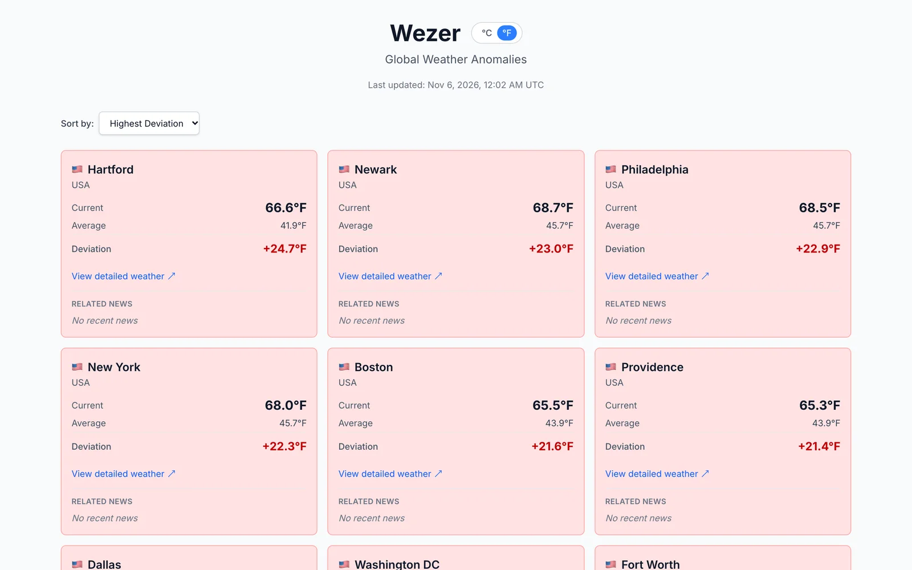
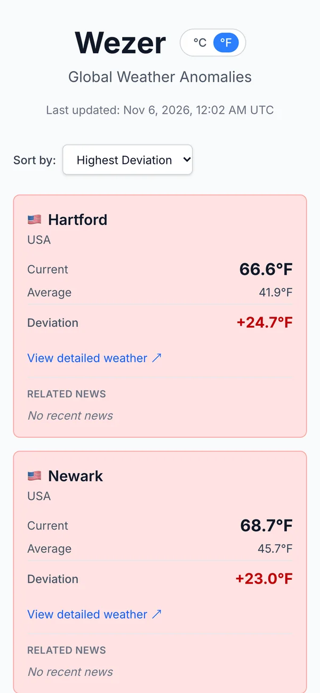
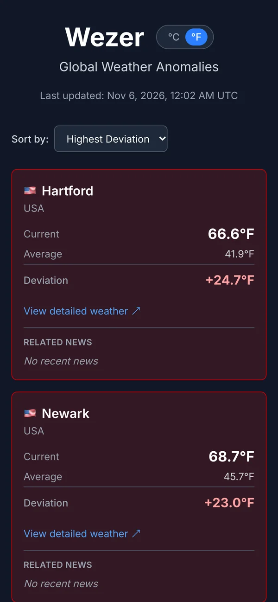

# Wezer

Where the weather is strangest right now: 178 cities ranked by how far their current
temperature is from the usual for today's date.

**Live at [wezer.vercel.app](https://wezer.vercel.app)**

<picture>
  <source media="(prefers-color-scheme: dark)" srcset="docs/screenshots/desktop-dark.webp">
  
</picture>

## Features

- **Anomaly ranking**: each city's current temperature minus its average for the day of the
  year. Warmer than usual is red, colder is blue.
- **178 cities**: 50 spread across every continent, then 66 more in the US, 52 more in
  Europe and 10 more large cities in Asia and Africa.
- **Sorting**: biggest or smallest deviation, hottest, coldest, or A-Z.
- **°C / °F toggle**: defaults from your browser locale and is remembered in localStorage.
- **News for the top 3**: weather headlines from GNews for the three biggest anomalies, when an
  API key is set.
- **Light and dark themes**: follows your system preference.

| Mobile, light | Mobile, dark |
| --- | --- |
|  |  |

## Development

```bash
pnpm install
pnpm dev            # http://localhost:3000
pnpm test           # Vitest in watch mode (pnpm test:run runs once)
pnpm lint
pnpm build
```

| Variable | Required | What |
| --- | --- | --- |
| `GNEWS_API_KEY` | No | [GNews](https://gnews.io/) key. Without it the news section shows "No recent news". |

Put it in `.env.local`. Weather data needs no key.

## How it's built

Next.js 16 (App Router), React 19, TypeScript, Tailwind CSS 4 and Vitest, deployed on Vercel.
The page is a server component that fetches the current temperature for every city from
[Open-Meteo](https://open-meteo.com/) in parallel, cached for an hour, then compares each one with
a built-in table of averages. News comes from [GNews](https://gnews.io/), cached for 24 hours to
stay inside the free tier's rate limit. The averages are hand-entered monthly values,
interpolated per day, not measured climate normals; `TODO.md` describes replacing them with
Open-Meteo archive data.

| Path | What |
| --- | --- |
| `src/lib/cities.ts` | City list with coordinates and country codes |
| `src/lib/historical-averages.ts` | Monthly averages per city and the daily interpolation |
| `src/lib/anomaly.ts` | Fetches weather, computes deviations, picks the top 3 for news |
| `src/lib/weather.ts`, `src/lib/news.ts` | Open-Meteo and GNews clients |
| `src/components/AnomalyDashboard.tsx` | Client-side sorting |
| `src/__tests__/` | Unit and component tests, including a check that every city has averages |
